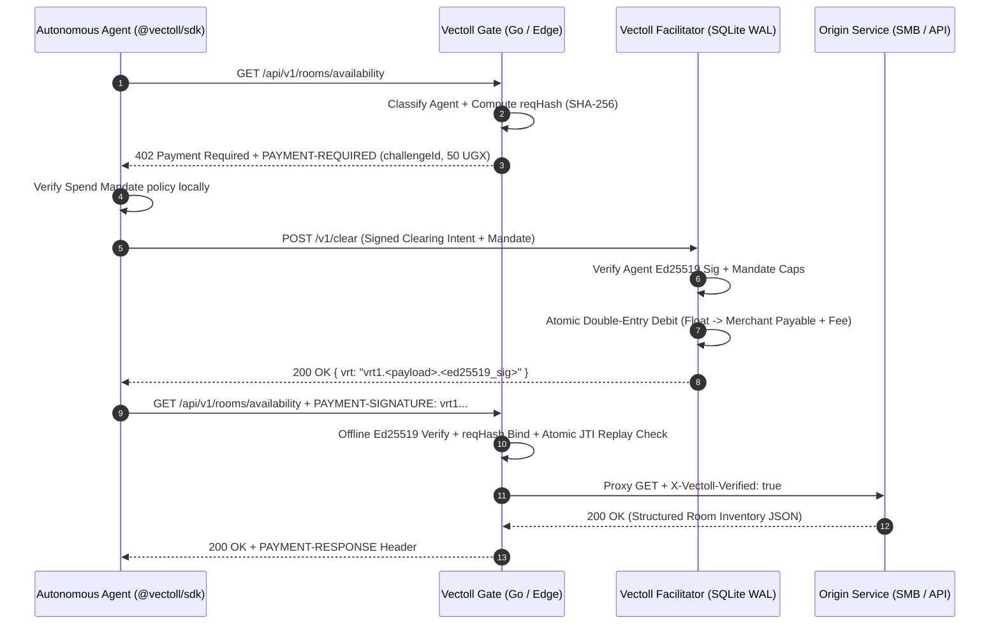
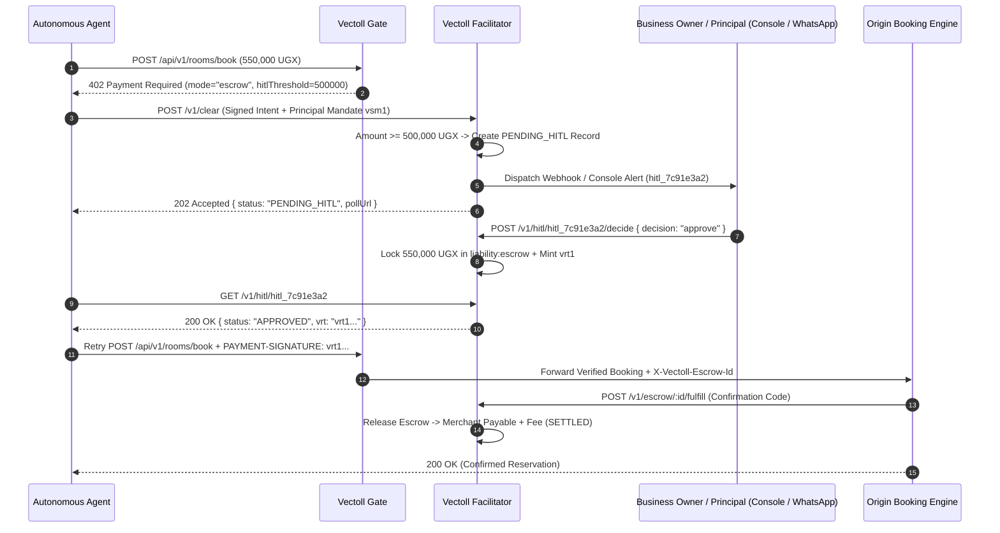

# Vectoll System Architecture & Engineering Deep Dive

## 1. Design Philosophy

Vectoll is architected around four hard engineering constraints:
1. **Hot-Path Independence:** Origin access verification at `vectoll-gate` **must never** make a synchronous network round-trip to the Facilitator. Every receipt (`vrt1`) is verified locally via Ed25519 public keys in `< 0.5 ms`.
2. **Asynchronous Rail Decoupling:** Agents require `< 200 ms` end-to-end tool calls; Mobile Money (USSD/STK Push) and bank rails settle in `5–30 s`. Vectoll's Two-Tier Clearing Engine absorbs external rail latency via prepaid float accounts and asynchronous merchant batch sweeps.
3. **Zero Floating-Point Money:** Every ledger entry, FX quote, spend mandate, and receipt uses 64-bit safe integer minor units with explicit `currency` + `decimals`.
4. **Defense Against Compromised or Hallucinating Agents:** Principal-signed Spend Mandates (`vsm1`) + Human-in-the-Loop (HITL) thresholds ensure bounded autonomy even when an agent's LLM context is manipulated.

---

## 2. End-to-End Sequence Flows

### 2.1 Instant Metered API Call (`< 50 ms` Clearing)

### 2.2 High-Value Booking with Escrow & HITL Approval

---

## 3. Component Breakdown

### 3.1 `services/gate` (Go Reverse Proxy) & `packages/edge` (Fetch Worker)
* **Config Engine:** Parses `vectoll.yaml` (or JSON manifest), compiles route matchers `(method, pathPattern)`, and exposes `GET /.well-known/vectoll.json`.
* **Classifier:** Inspects `User-Agent`, `Accept`, `Sec-Fetch-*`, and `X-Vectoll-*` headers to allow zero-latency human browser browsing on `human_passthrough: true` routes while challenging bots, scrapers, and SDK clients.
* **Rate Limiter:** Per-IP token bucket guard rejecting volumetric floods before signature parsing or Origin forwarding.
* **Ed25519 Verifier & Replay Cache:** Validates `vrt1` signatures against configured or JWKS-fetched Facilitator public keys and records `jti` nonces in a TTL-evicted concurrent map (or Redis/Valkey in clustered deployments).
* **MCP Gateway (`POST /mcp`):** Translates `vectoll.yaml` routes annotated with `mcp_tool` into live MCP tools (`initialize`, `tools/list`, `tools/call`) with zero Origin code changes.

### 3.2 `packages/facilitator` (Node 24 + `node:sqlite` WAL)
* **Storage Engine:** Uses SQLite in Write-Ahead Logging (`PRAGMA journal_mode = WAL; PRAGMA foreign_keys = ON;`) with `BEGIN IMMEDIATE` serializable write transactions so concurrent clearing calls can never race-spend the same float balance.
* **Ledger Tables:** `accounts`, `journal_transactions`, `journal_entries`, `mandate_usage`, `escrows`, `hitl_approvals`, `payouts`, and `telemetry_events`.
* **Endpoints:**
  * `GET /health` & `GET /.well-known/jwks.json`
  * `POST /v1/wallets/topup` — Fund an agent wallet via any registered `VectollRailAdapter`
  * `GET /v1/wallets/:agentId` — Query multi-currency balances and 24h spend
  * `POST /v1/clear` — Verify agent signature + mandate and issue `vrt1` (or `202 PENDING_HITL`)
  * `GET /v1/hitl` & `POST /v1/hitl/:id/decide` — List and approve/reject HITL requests
  * `POST /v1/escrow/:id/fulfill` & `POST /v1/escrow/:id/refund` — Settle or refund escrow locks
  * `POST /v1/payouts` — Trigger merchant payout batch via Mobile Money, Stripe, or USDC
  * `GET /v1/ledger/entries` & `GET /v1/ledger/export?format=csv|json` — Audit & ERP export
  * `GET /v1/telemetry/summary` — Real-time metrics powering `vectoll-console`

### 3.3 `packages/adapters` (Multi-Rail & FX Layer)
* Deterministic integer FX rate table (`USD`, `USDC`, `EUR`, `UGX`, `KES`, `NGN`, `GHS`) with configurable spread/slippage basis points (`maxSlippageBps`) and live provider hook overrides.
* Pluggable registry (`AdapterRegistry`) supporting instant registration of first-party and third-party custom rails.
